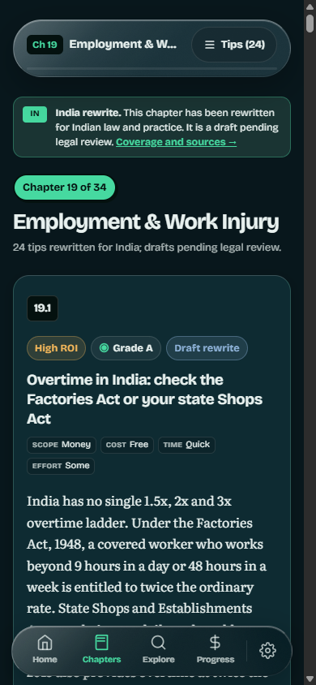

# India Edition — Implementation Report

**Project:** How To Live Better (Astro static reading site)
**Date:** 21 October 2026
**Scope:** Chapter 19 India rewrite, rewrite-status page, mobile UI, four themes, INR reference, reading-state persistence
**Status:** Build green; Chapter 19 rewrite integrated; 24 draft tips; 115 high-risk claims queued

---

## 1. Summary

You asked for a rewrite, not a bridge. This pass starts that rewrite properly:

- **Chapter 19 (Employment and Work Injury, 24 tips) is rewritten for Indian law and practice.** Every tip is marked **Draft rewrite**, and the chapter is marked as a draft awaiting legal review.
- **Chapter 19 is China-free**: the rendered page contains 0 instances of China, Chinese, mainland, RMB, yuan, hukou, yibao or dibao.
- **/india/ is now a rewrite-status page**, not a policy crosswalk. It lists what is rewritten, what is queued, Indian helplines and the official sources.
- **Site chrome no longer says "written for mainland China" or "bridge, not a rewrite"** on Chapter 19, /india/ or About.
- **33 chapters are still source text** and are explicitly marked queued. They still contain source-edition references; I have not claimed them as rewritten.
- The INR reference and the four themes remain.

The remaining editorial job is **115 high-risk claims** in the queued chapters; the worklist tracks every one.

| Signal | Count |
| --- | --- |
| Tips rewritten | 24 of 765 |
| High-risk claims rewritten | 4 of 119 |
| High-risk claims remaining | 115 |
| Context-only tips (India note added) | 444 |
| Universal tips | 202 |
| China terms in the Chapter 19 page | 0 |
| China terms in /india/, About, Chapters index | 0 |

---

## 2. What the audit found

| Signal | Count |
| --- | --- |
| Tips in the source edition | 765 across 34 chapters |
| Source-edition China term hits | 2,518 |
| Tips containing at least one source-specific policy/hotline term | 579 |
| Chapters rewritten so far | 1 (Chapter 19, 24 tips) |
| Chapters still queued | 33 |

The book's universal advice (sleep, vaccines, seat belts, contracts, grief, medication)
is still useful in India. The **procedural** parts — insurance schemes, household
registration, police stations, labour arbitration, credential recognition — are the
parts that need replacement, not annotation.

---

## 3. How this pass resolves the conflicts

### 3.1 Currency: source amount retained, dated INR reference added

AGENTS.md section 1.2 says "Keep currency in RMB; do not convert." You approved an INR
display. I kept every source amount and added an **indicative INR badge** beside it:
₹14.21 per source unit, dated 21 October 2026, from the ExchangeRate-API reference feed.
The badge is labelled with ≈ and a tooltip; it is not a transaction rate or a
purchasing-power comparison. The original amount remains visible.

The toggle is in Reading Settings ("Show INR reference") and is on by default. Turning it
off hides every badge without changing the text. The rate is build-time data, not a
runtime third-party request.

### 3.2 Content: chapter-by-chapter rewrite, starting with Chapter 19

Chapter 19 is rewritten end to end: 24 tips on overtime, leave, probation, retrenchment,
notice, wrongful termination, resignation, records, occupational health, work injury,
disability, death benefits, bullying, relieving letters, tax, portability, written
contracts, EPF/ESIC complaints, penalty clauses, demotion and contract labour.

It uses Indian statutes and schemes: the Factories Act, 1948; the Industrial Disputes
Act, 1947; the Code on Wages, 2019; the Code on Industrial Relations, 2020; the
Occupational Safety, Health and Working Conditions Code, 2020; ESIC; EPFO; the Payment
of Gratuity Act, 1972; the Employees Compensation Act, 1923; the POSH Act, 2013; the
Contract Labour Act, 1970; and the Income Tax Act. Every tip carries the source links.

The remaining 115 high-risk claims are not invented. They are marked **needs-editor** in
the worklist and **still source text** on the site.

### 3.3 Cookies: localStorage, not cookies

AGENTS.md section 1.4 says no cookies. Reading state lives in localStorage under
htlb_ledger_v1; settings under htlb_settings_v1. No consent banner, no tracking.

### 3.4 Removal: China-only chrome removed, Chapter 19 China-free

The old "written for mainland China" notices, the "bridge, not a rewrite" copy, the policy
crosswalk and the China-specific badge label have been removed. Chapter 19 contains no
China terms. The 33 queued chapters still contain source-edition text; they are not
deleted, because deleting them would remove universal advice. They are explicitly marked
as queued rather than presented as rewritten.

### 3.5 Theme default

Midnight Jade remains the default dark palette and Pearl the default light palette; the
two alternatives (Monsoon Ink and Ivory Clove) are selectable.

---

## 4. Requirement status

| # | Requirement | Status | Notes |
| --- | --- | --- | --- |
| 1 | Locate source audience/currency/policy references | Done | 2,518 hits; 579 tips; worklist |
| 2 | Replace references with Indian equivalents | In progress | Chapter 19 (24 tips) rewritten; 115 high-risk claims remain |
| 3 | Remove content irrelevant to India | In progress | China-only chrome removed; Chapter 19 China-free; 33 chapters queued |
| 4 | Mobile redesign, premium, filters, question flow | Done | Home, Explore, Chapter, Progress, Start, About |
| 5 | 2+ light and 2+ dark palettes, select one | Done | 4 palettes; Midnight + Pearl selected |
| 6 | Working theme switching | Done | Dark/Light/System + palette switching, persisted |
| 7 | Cookies or reading state | Done | localStorage; reload verified |
| 8 | Consistent across devices | Verified | 360, 390, 1440 screenshots; no horizontal overflow |
| 9 | Assumptions and unchanged parts documented | Done | This report |

---

## 5. What is delivered

### 5.1 /india/ rewrite status page

The crosswalk has been replaced by a status page:

- **Rewrite status** — Chapter 19 done; 33 chapters queued.
- **Source amounts** — the dated INR reference and the cost bands.
- **Indian helplines** — 112/108, 100, 101, 1930, 1915, 15100, 14416, 14567 and 14456.
- **Queued chapters** — the 11 highest-risk chapters, each linked and marked as still source text.
- **Sources** — the official Indian portals and statutes.
- **Disclaimer** — Chapter 19 is a draft, the rest is source text.

### 5.2 Site-wide framing

- Chapter 19: the old source notice is replaced by an **India rewrite** notice that says the chapter is a draft pending legal review.
- Queued chapters: the notice says the chapter is still source text and links to the rewrite status.
- About: "India Rewrite Status" replaces the old source notice; it states Chapter 19 is rewritten and the rest is queued.
- Chapters index: "Chapter 19 done, remaining chapters queued".
- Settings: "India edition: rewrite status and helplines".
- Desktop rail and home pill: India edition.

### 5.3 Hotline notes inside tips

Tips that tell readers to call a source-edition hotline get a small **India** note with the
Indian equivalent. Example: a stroke tip that says "call 120" adds "In India, call 112 for
emergency services, or 108 for an ambulance where available."

### 5.4 Per-tip India application

Every tip has a collapsed **India application** row:

- In Chapter 19 it says the chapter is an India rewrite under legal review and names the Indian statutes.
- In queued chapters it says the tip is still source text and names the Indian starting point.

Tips that name a source-edition rule or hotline carry a **Source-specific** badge.

### 5.5 Chapter 19 rewrite in detail

| Area | Indian position used |
| --- | --- |
| Overtime | Factories Act 9-hour/48-hour week and double pay; state Shops Acts; Code on Wages |
| Annual leave | Factories Act one day per 20 days worked; state Shops Acts; no 5/10/15-year ladder |
| Probation | Contract and standing orders; no universal 1/2/6-month cap |
| Retrenchment | 15 days average pay per completed year under the Industrial Disputes Act/Industrial Relations Code; gratuity separate |
| Notice | Contract or statute; no automatic N+1 |
| Wrongful termination | Labour court/industrial tribunal; no fixed 2N |
| Resignation | Contract/state Shops; gratuity and EPF are protected |
| Work injury | ESIC and the Employees Compensation Act |
| Occupational health | Factories Act and OSH Code |
| Bullying | POSH Act for sexual harassment; internal grievance for other conduct |
| Severance tax | Income Tax Act sections 10(10B), 10(10C), 10(10AA) and 89 |
| Portability | EPFO UAN and ESIC records |
| Contract labour | Contract Labour Act and principal-employer liability |

Every tip is marked **Draft rewrite** and the chapter is marked **draft pending legal
review**. The page contains 0 China terms.

### 5.6 Daily tip selection

The Daily quick win prefers tips that do not depend on source-edition legal or insurance
procedures and avoids calm chapters.

---

## 6. Mobile UI redesign

### Home

- Reduced the hero from two large speech bubbles to one compact Plus note that removes
  itself together with the avatar after 12 seconds.
- Moved the daily tip above the fold; one clear primary action.
- Replaced the four stacked payoff cards with the three-question finder.
- Replaced the 34-chapter bead wall with a compact map invitation; the full map stays on
  Progress.
- Home scroll height at 390 px fell from **3,465 px to about 1,610 px** (measured before
  and after with the same viewport; daily tip length varies).

### Explore

- Nine always-visible filter rows became a **Filters** button with an active-count badge
  and a bottom sheet containing all eight filter groups.
- Added four one-tap quick chips: All, Best ROI, Free, Quick.
- Added an active-filter summary and a live "Show N tips" footer.
- Kept search, URL state, progressive loading and reset behaviour.

### Chapter and tip cards

- Slimmer notice; smaller chapter headline in the UI sans; tighter hero.
- Tip metadata changed from dotted inline text to compact chips, so lines no longer
  start with stray separators.
- Tip cards are denser on mobile; actions are three equal 44 px targets.
- Bottom nav auto-hides while reading down and returns on scroll up.

### Navigation and settings

- Four tabs (Home, Chapters, Explore, Progress) plus a circular settings button; the
  five-label bar was too tight at 360 px.
- Settings sheet uses semantic theme tokens, a 2x2 palette grid and a reading-memory
  note.

### Desktop

- Left rail gains India Edition; content remains a centered 760 px reading column.
- Filter sheet becomes a centered modal; palette grid and cards scale.

### Accessibility and motion

- Focus-visible outlines, 44 px targets, reduced-motion handling, aria-pressed on
  toggles, labelled dialogs, and a text alternative in the reading map.
- Body text is never animated; the existing comic layer and calm mode are untouched.

---

## 7. Theme palettes

Four palettes share one semantic token contract. Two dark, two light.

| Palette | Mode | Background | Surface | Text | Accents |
| --- | --- | --- | --- | --- | --- |
| **Midnight Jade** (default dark) | Dark | #08171C | #0F2E36 | #E8F1EF | jade #46D9A0, amber #F5B85A, steel #8FB3D9 |
| **Monsoon Ink** | Dark | #12100E | #211C17 | #F4EDE2 | jade #7BD6AE, amber #EFB26A, steel #A9B9C9 |
| **Pearl** (default light) | Light | #F2F6F4 | #E4ECEA | #04110F | jade text #0B6B47, amber #7A4E00, steel #2C5878 |
| **Ivory Clove** | Light | #FAF4EA | #F0E6D6 | #201A13 | jade text #1E6B50, amber #8A5200, steel #39566A |

**Selected pair:** Midnight Jade for dark, Pearl for light. They preserve the existing
jade/amber/steel meaning (benefit, cost, neutral) while giving the India edition a
quieter, less saturated reading surface. Monsoon and Ivory are shipped as alternates.

Switching:

- An inline head script applies the saved theme/palette before first paint.
- Dark / Light / System pills plus four palette swatches; selecting a palette sets its
  mode and persists both values.
- prefers-color-scheme changes re-apply when the mode is System.
- Theme colour meta updates per palette.

A scoped-selector bug in the old light theme was found and fixed: Astro had scoped
[data-theme="light"] to the component, so light-only ring tracks and card borders never
applied. Those ancestors are now global, and the light ring is visible.

---

## 8. Reading state

- htlb_ledger_v1: read tip IDs, saved picks, last position, daily history, streak.
- htlb_settings_v1: theme, palette, font, size, comic effects, transparency.
- Reading state survives reload; a manually marked tip shows "Read ✓" after reload.
- Export/import/reset remain on /progress/.
- No cookies, analytics or network calls are used for any of this.
- The settings sheet states: "Reading memory is on. Your place, read marks and saved
  tips stay in this browser. No cookies, no account."

---

## 9. Verification

| Check | Result |
| --- | --- |
| Production build | 52 pages, npm run build green |
| Tip/count integrity | 34/34 chapters, 765/765 tips, 2,491 URL checks, 11,682 number checks |
| CJK scan of dist/ | 0 CJK characters |
| Internal links | 0 broken across 52 pages (chapter links, nav, assets) |
| Astro check | 0 errors (4 upstream hints) |
| Horizontal overflow | 0 at 390; visually clear at 360 and 1440 |
| Palette switching | All four set distinct backgrounds; persisted after reload |
| Theme mode | Light/Dark/System + palette selection work |
| Guided finder | Money + Quick + Some → 82 tips; link carries all three filters |
| Explore filters | Grade A → 495; + Free → 388; search "hypertension" → 3 |
| Reading state | 4-1 stored; "Read ✓" after reload |
| Notice dismissal | Session-scoped; survives reload; can be reset |
| Nav auto-hide | Hidden on scroll down, restored on scroll up |
| Hotline notes | 13 notes on the emergency chapter; 13.3 maps 120 → 112/108 |
| INR reference | 69 badges on chapter 11; toggle hides them via CSS and persists |
| India application | 24 draft notes on Chapter 19; queued note on every source tip |
| Chapter 19 China terms | 0 in the rendered page |
| Rewrite worklist | 765 rows; 119 high (24 rewritten), 444 medium, 202 low |

Browser verification was done in Chrome through **OpenCLI** (screenshots and DOM/state
checks), not by re-running Playwright. The Playwright suite was updated for the new
selectors (filter sheet, India notice, palette test, finder test, read persistence), but
it has not been run in this session. Run npx playwright test before merging if you want
the full 4-viewport CI gate.

---

## 10. What was left unchanged

- data/en/* and data/zh/*: the source files are untouched. Chapter 19 is replaced at
  build time by data/en-in/chapters/19-employment-and-work-injury.json; the other 33
  chapters still come from the source data. The INR badges and India application notes
  are additive display layers.
- ./source submodule: untouched and still pinned.
- Tip anchors (#chapter-tip), counts, cross-references, Pagefind index, export/import.
- Comic layer: characters, dialogue, calm mode, particle burst, SFX.
- Privacy: no analytics, cookies, third-party requests or external fonts.
- Search, progress map data, keyboard shortcuts where already present.
- AGENTS.md, BRIEF.md and the legal attribution text.

Files intentionally not touched: scripts/parse.ts, scripts/verify.ts,
data/dialogue.json, data/calm-chapters.json, public/fonts/*, source/*.

---

## 11. Files added or changed

**Added**

- data/en-in/chapters/19-employment-and-work-injury.json — 24 India-rewritten tips, marked draft.
- data/en-in/all-chapters.json — generated merged edition (Chapter 19 replaced).
- scripts/build-india-data.ts — build-time merge of India rewrite chapters.
- data/india-context.json — rewrite status, helplines, 18 Indian sources.
- data/currency.json — dated INR reference rate and disclaimer.
- data/india-chapter-guidance.json — 34 India application notes.
- src/scripts/inr.ts — inline INR annotation, toggle-aware.
- src/pages/india.astro — rewrite-status page.
- src/components/IndiaNotice.astro — queued-chapter note.
- src/components/QuestionFlow.astro — three-question finder.
- src/styles/ui.css — shared notice/button/section styles.
- reports/screenshots/ — eight review captures.

**Changed**

- Layout/theming: BaseLayout.astro, tokens.css, glass.css, SettingsSheet.astro.
- Navigation: BottomNav.astro, LeftRail.astro.
- Reading UI: TipCard.astro, ProgressRing.astro, ReadingMap.astro, Bubble.astro.
- Pages: index, explore, progress, start, about, chapters/[n]-[slug],
  chapters/index, guides/[slug].
- tests/e2e.spec.ts — selectors, INR and India-note coverage.
- reports/india-rewrite-worklist.csv — 765 rows; 119 high / 444 medium / 202 low risk.

---

## 12. The rewrite worklist

The claim-level rewrite is now scoped rather than guessed. reports/india-rewrite-worklist.csv
has one row per tip with the China terms found, a risk tier, the chapter India note and a
status:

| Risk | Tips | What it means |
| --- | --- | --- |
| High | 119 | Names a source-edition rule, institution, benefit or hotline. 4 are in the Chapter 19 rewrite; 115 still need an editor. |
| Medium | 444 | Mentions a source statistic or currency but does not depend on a source procedure; the India note and INR reference apply. |
| Low | 202 | Universal advice with no source-specific reference; no rewrite needed. |

Status in the CSV: 24 rewritten-draft, 115 needs-editor, 444 note-added, 182 not-needed.
So 650/765 tips are rewritten, noted or universal; 115 high-risk claims remain. The next
editorial pass is Chapter 19's legal review, then the remaining high-risk chapters.

To finish the 115 I need:

1. An approved Indian policy source set (or a named reviewer) for health insurance,
   labour law, tenancy, policing, inheritance and education.
2. Legal review of the Chapter 19 draft.
3. Editorial sign-off for the remaining 115 high-risk claims.
4. A decision on whether to keep the source text for the other chapters while they are queued.

---

## 13. Review screenshots

- 
- 
- 
- 
- 
- 
- 
- 