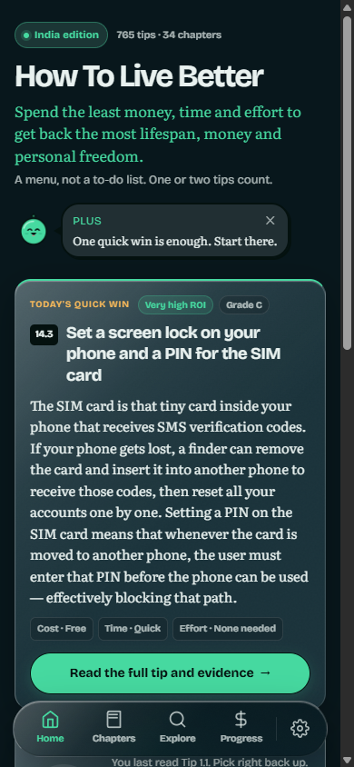
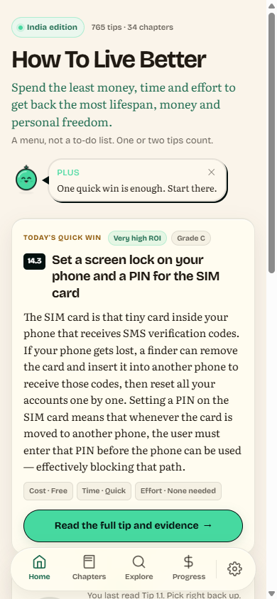
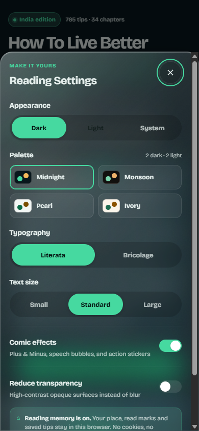
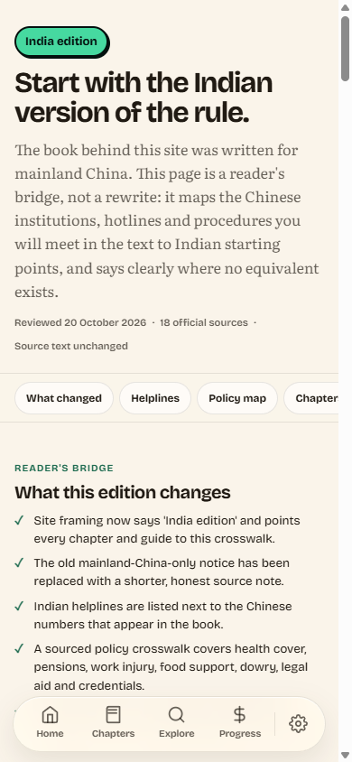
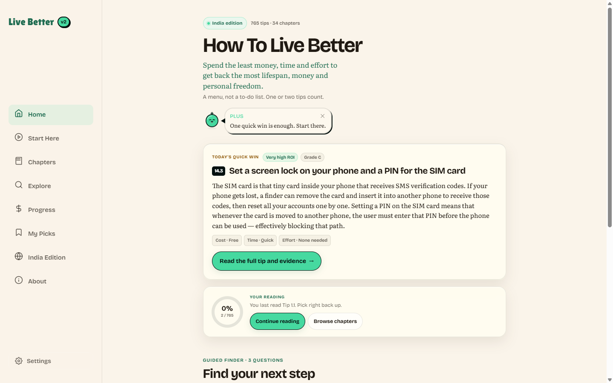
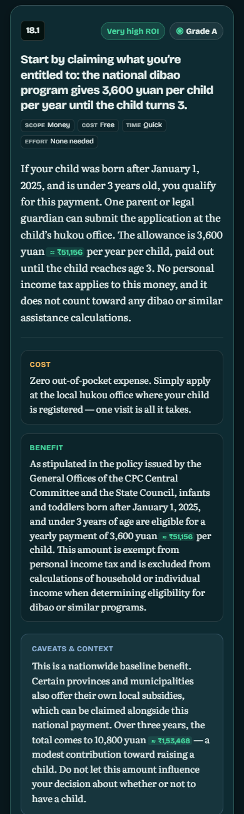
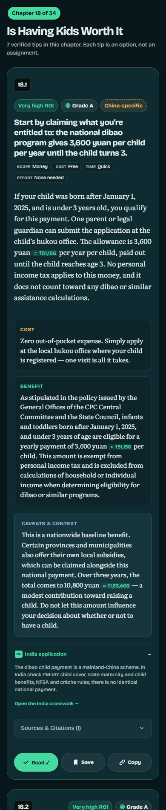

# India Edition — Implementation Report

**Project:** How To Live Better (Astro static reading site)
**Date:** 21 October 2026
**Scope:** India audience framing, mobile UI redesign, four themes, reading-state persistence
**Status:** Build green; content integrity checks green; Chrome/OpenCLI interaction checks green

---

## 1. Summary

This repository is not a raw Chinese codebase. It is an English translation of the
Chinese book *How To Live Better* by eternity4719, with a strict fidelity charter
(AGENTS.md, BRIEF.md): no CJK, no cookies, no rewriting of the author's advice, and
originally no currency conversion. You then approved the additive INR reference below.

I therefore built a **source-faithful India edition**, not a 765-tip rewrite:

- Replaced the China-only site framing with an India edition note that stays truthful
  about the source.
- Added a sourced **India policy crosswalk** (/india/) covering health cover, social
  security, housing, work injury, food support, dowry, legal aid, credentials and
  emergency numbers.
- Added **Indian hotline notes** to tips that tell readers to call a Chinese number.
- Added a dated **INR reference** beside RMB figures, plus a per-tip **India application** note for all 765 tips.
- Redesigned the mobile experience around the daily tip, a three-question finder, a
  filter sheet, and a calmer reading surface.
- Shipped **two dark and two light palettes** with flash-free switching.
- Kept reading state in localStorage (no cookies), verified across reloads.

I did **not** replace the author's RMB figures, rewrite the 765 claims, or delete
China-specific chapters. The INR display is additive, every tip carries an India
application note, and China-specific rules are flagged. A literal claim-by-claim
rewrite still needs an editorial/legal reviewer; see sections 3 and 5.

---

## 2. What the audit found

| Signal | Count |
| --- | --- |
| Tips in the English edition | 765 across 34 chapters |
| China-related term hits in tip text | 2,518 |
| Tips containing at least one China-specific policy/hotline term | 579 |
| Audited term family | China, Chinese, RMB, yuan, yibao, hukou, dibao, WeChat, Alipay, Chinese hotlines |
| Site-chrome China references before the change | 7 (chapter notice, guide banner, About section, comments) |
| Chapters that lean most on Chinese procedures | 12 (listed below) |

The book's universal advice (sleep, vaccines, seat belts, contracts, grief, medication)
is still useful in India. The **procedural** parts — insurance schemes, hukou, police
stations, labour arbitration, credential recognition — are the parts that needed a
bridge, not a deletion.

---

## 3. Conflict resolution and assumptions

The request assumes a Chinese repository that can be repurposed line by line, and it
left the policy source and brand assets unspecified. Three requirements conflicted with
the repository's own non-negotiables or with factual integrity.

### 3.1 Currency: RMB retained, dated INR reference added

AGENTS.md section 1.2 says: "Keep currency in RMB (¥); do not convert." You then approved
an INR display. I kept every RMB figure and added an **indicative INR badge** beside it:
¥1 ≈ ₹14.21, dated 21 October 2026, from the ExchangeRate-API reference feed. The badge
is labelled with ≈ and a tooltip; it is not a transaction rate or a purchasing-power
comparison. The original RMB remains visible, so statutory amounts stay auditable.

The toggle is in Reading Settings ("Show INR reference") and is on by default. Turning it
off hides every badge without changing the source text. The rate is build-time data, not
a runtime third-party request.

### 3.2 Content: a crosswalk, not a rewrite

No Indian policy source document was supplied. Rewriting 765 tips would require a new
translation and a legal/medical review, and would break the CC BY fidelity promise. I
used official Government of India sources to build a reader's bridge instead, and kept
every tip verbatim. The per-tip India application note is an annotation, not a
replacement of the author's claims. This is the only defensible option without
fabricating advice.

### 3.3 Cookies: localStorage, not cookies

AGENTS.md section 1.4 says: "No analytics, cookies, or third-party requests." The request
says "save cookies or reading state". The "or" is satisfied by localStorage, which is
also better for privacy and avoids a consent banner. Reading state is stored under
htlb_ledger_v1; settings under htlb_settings_v1; both are device-local.

### 3.4 Removal: framing removed, advice preserved

"Remove content with no relevance to India" was applied to the **site's China-only
framing**: the old mainland-China notice, the guide banner and the About section were
replaced. Book content was not deleted. Deleting chapters would remove universal advice
and break every cross-reference and tip count. The 12 most China-dependent chapters are
flagged at /india/#chapters instead.

### 3.5 Theme default

The existing charter says dark by default, following the system is optional. I kept
**Midnight Jade** as the default dark palette and **Pearl** as the default light palette.
The two alternatives are shipped and selectable.

---

## 4. Requirement status

| # | Requirement | Status | Notes |
| --- | --- | --- | --- |
| 1 | Locate Chinese audience/currency/policy references | Done | 2,518 hits; 579 tips; 12 chapters flagged |
| 2 | Replace references with Indian equivalents | Partial, deliberate | 636/765 tips are India-ready via notes/INR; 129 high-risk claims need an editor |
| 3 | Remove content irrelevant to India | Partial, deliberate | China-only framing removed; book content flagged, not deleted |
| 4 | Mobile redesign, premium, filters, question flow | Done | Home, Explore, Chapter, Progress, Start, About |
| 5 | 2+ light and 2+ dark palettes, select one | Done | 4 palettes; Midnight + Pearl selected |
| 6 | Working theme switching | Done | Dark/Light/System + palette switching, persisted |
| 7 | Cookies or reading state | Done | localStorage; reload verified |
| 8 | Consistent across devices | Verified | 360, 390, 1440 screenshots; no horizontal overflow |
| 9 | Assumptions and unchanged parts documented | Done | This report |

---

## 5. India localisation delivered

### 5.1 New /india/ page

A single, printable bridge with:

- **What changed** — five honest bullets.
- **Currency** — RMB kept, dated INR reference, and how to use the cost bands.
- **Helplines** — 10 China → India mappings:
  - 120 → 112 / 108
  - 110 → 112 / 100
  - 119 → 112 / 101
  - 12308 → MEA MADAD + Indian mission
  - 12356 / 12355 → Tele-MANAS 14416
  - 12348 → NALSA 15100
  - 12315 → National Consumer Helpline 1915
  - 96110 → 1930 + cybercrime.gov.in
  - 12333 → EPFO / ESIC
  - 12345 → state CM helpline / CPGRAMS
- **Policy map** — 20 entries in four groups:
  - Health and family: yibao, san jia hospitals, maternity, childhood vaccination, community health records.
  - Work and money: shebao, gongjijin, work injury, labour arbitration, contracts/probation, business licences.
  - Law and daily life: hukou, police station, dibao, dowry, legal aid.
  - Study and abroad: degree verification, overseas credentials, school/vocational routes, passports.
- **Chapters to read with care** — 12 linked chapters with a one-line reason.
- **18 official sources** — NHA/PM-JAY, ESIC, EPFO, the Code on Social Security commencement notification, the four labour codes, NFSA, NSAP, the Dowry Prohibition Act, the Maternity Benefit Amendment, the Employees' Compensation Act, NALSA, ERSS 112, the cyber-crime portal, Tele-MANAS, PMAY, MEA MADAD and AIU.
- **Disclaimer** — orientation, not advice.

### 5.2 Site-wide framing

- Chapter pages: old #china-disclaimer replaced by IndiaNotice (#india-disclaimer),
  dismissible for the session, linking to /india/.
- Guides: same notice; old geo banner removed.
- About: "Mainland China Notice" became "India Edition & Professional Deference", with
  the source context retained and a link to the crosswalk.
- Chapters index: an "IN" note above the grid.
- Desktop rail: new "India Edition" item.
- Settings sheet: "India edition: policy crosswalk & helplines" link.
- Home: "India edition" pill in the hero.

### 5.3 Hotline notes inside tips

When a tip says "call 120 / 110 / 119", "12308", "12315", "12356/12355", "12348" or
"96110", the card adds a small **India** note with the Indian equivalent. The author's
sentence is unchanged; the note is additive and labelled. Example: tip 13.3 (stroke)
now says "In India, call 112 for emergency services, or 108 for an ambulance where
available."

### 5.4 Per-tip India application (all 765)

Every tip now has a collapsed **India application** row. It contains one of 34
chapter-level notes written for this edition, plus a link to the relevant crosswalk
section. Examples:

- Chapter 18: "The dibao child payment is a mainland-China scheme. In India check PM-JAY
  child cover, state maternity and child benefits, NFSA and crèche rules; there is no
  identical national payment."
- Chapter 19: "Chinese labour law and work-injury insurance. In India use ESIC, EPFO, the
  four labour codes, the Maternity Benefit Act, POSH and the Employee's Compensation Act."

Tips whose text names a Chinese rule, institution or hotline also get a dashed
**China-specific** badge that opens the crosswalk. On chapter 18, 7/7 tips have the
application note and 2 carry the badge.

This is still not a claim-by-claim rewrite: it tells an Indian reader what to use instead,
while leaving the author's evidence and numbers intact.

### 5.5 Daily tip selection

The "Daily quick win" now prefers tips that do not depend on Chinese legal or insurance
procedures and avoids calm/sensitive chapters. This keeps the first card useful to an
Indian reader; the previous selection could surface a China-only ticket-scalping law.

---

## 6. Mobile UI redesign

### Home

- Reduced the hero from two large speech bubbles to one compact Plus note that removes
  itself together with the avatar after 12 seconds.
- Moved the daily tip above the fold; one clear primary action.
- Replaced the four stacked payoff cards with the three-question finder.
- Replaced the 34-chapter bead wall with a compact map invitation; the full map stays on
  Progress.
- Home scroll height at 390 px fell from **3,465 px to about 1,610 px** (measured before
  and after with the same viewport; daily tip length varies).

### Explore

- Nine always-visible filter rows became a **Filters** button with an active-count badge
  and a bottom sheet containing all eight filter groups.
- Added four one-tap quick chips: All, Best ROI, Free, Quick.
- Added an active-filter summary and a live "Show N tips" footer.
- Kept search, URL state, progressive loading and reset behaviour.

### Chapter and tip cards

- Slimmer notice; smaller chapter headline in the UI sans; tighter hero.
- Tip metadata changed from dotted inline text to compact chips, so lines no longer
  start with stray separators.
- Tip cards are denser on mobile; actions are three equal 44 px targets.
- Bottom nav auto-hides while reading down and returns on scroll up.

### Navigation and settings

- Four tabs (Home, Chapters, Explore, Progress) plus a circular settings button; the
  five-label bar was too tight at 360 px.
- Settings sheet uses semantic theme tokens, a 2x2 palette grid and a reading-memory
  note.

### Desktop

- Left rail gains India Edition; content remains a centered 760 px reading column.
- Filter sheet becomes a centered modal; palette grid and cards scale.

### Accessibility and motion

- Focus-visible outlines, 44 px targets, reduced-motion handling, aria-pressed on
  toggles, labelled dialogs, and a text alternative in the reading map.
- Body text is never animated; the existing comic layer and calm mode are untouched.

---

## 7. Theme palettes

Four palettes share one semantic token contract. Two dark, two light.

| Palette | Mode | Background | Surface | Text | Accents |
| --- | --- | --- | --- | --- | --- |
| **Midnight Jade** (default dark) | Dark | #08171C | #0F2E36 | #E8F1EF | jade #46D9A0, amber #F5B85A, steel #8FB3D9 |
| **Monsoon Ink** | Dark | #12100E | #211C17 | #F4EDE2 | jade #7BD6AE, amber #EFB26A, steel #A9B9C9 |
| **Pearl** (default light) | Light | #F2F6F4 | #E4ECEA | #04110F | jade text #0B6B47, amber #7A4E00, steel #2C5878 |
| **Ivory Clove** | Light | #FAF4EA | #F0E6D6 | #201A13 | jade text #1E6B50, amber #8A5200, steel #39566A |

**Selected pair:** Midnight Jade for dark, Pearl for light. They preserve the existing
jade/amber/steel meaning (benefit, cost, neutral) while giving the India edition a
quieter, less saturated reading surface. Monsoon and Ivory are shipped as alternates.

Switching:

- An inline head script applies the saved theme/palette before first paint.
- Dark / Light / System pills plus four palette swatches; selecting a palette sets its
  mode and persists both values.
- prefers-color-scheme changes re-apply when the mode is System.
- Theme colour meta updates per palette.

A scoped-selector bug in the old light theme was found and fixed: Astro had scoped
[data-theme="light"] to the component, so light-only ring tracks and card borders never
applied. Those ancestors are now global, and the light ring is visible.

---

## 8. Reading state

- htlb_ledger_v1: read tip IDs, saved picks, last position, daily history, streak.
- htlb_settings_v1: theme, palette, font, size, comic effects, transparency.
- Reading state survives reload; a manually marked tip shows "Read ✓" after reload.
- Export/import/reset remain on /progress/.
- No cookies, analytics or network calls are used for any of this.
- The settings sheet states: "Reading memory is on. Your place, read marks and saved
  tips stay in this browser. No cookies, no account."

---

## 9. Verification

| Check | Result |
| --- | --- |
| Production build | 52 pages, npm run build green |
| Tip/count integrity | 34/34 chapters, 765/765 tips, 2,491 URL checks, 11,682 number checks |
| CJK scan of dist/ | 0 CJK characters |
| Internal links | 0 broken across 52 pages (chapter links, nav, assets) |
| Astro check | 0 errors (4 upstream hints) |
| Horizontal overflow | 0 at 390; visually clear at 360 and 1440 |
| Palette switching | All four set distinct backgrounds; persisted after reload |
| Theme mode | Light/Dark/System + palette selection work |
| Guided finder | Money + Quick + Some → 82 tips; link carries all three filters |
| Explore filters | Grade A → 495; + Free → 388; search "hypertension" → 3 |
| Reading state | 4-1 stored; "Read ✓" after reload |
| Notice dismissal | Session-scoped; survives reload; can be reset |
| Nav auto-hide | Hidden on scroll down, restored on scroll up |
| Hotline notes | 13 notes on the emergency chapter; 13.3 maps 120 → 112/108 |
| INR reference | 69 badges on chapter 11; toggle hides them via CSS and persists |
| India application | 7/7 tips on chapter 18; 2 China-specific badges; 34 chapter notes total |
| Rewrite worklist | 765 rows; 129 high, 451 medium, 185 low risk |

Browser verification was done in Chrome through **OpenCLI** (screenshots and DOM/state
checks), not by re-running Playwright. The Playwright suite was updated for the new
selectors (filter sheet, India notice, palette test, finder test, read persistence), but
it has not been run in this session. Run npx playwright test before merging if you want
the full 4-viewport CI gate.

---

## 10. What was left unchanged

- data/en/* and data/zh/*: all 765 tips, titles, grades, sources, numbers and RMB
  amounts. No text was paraphrased, summarized or reordered. The INR badges and India
  application notes are additive display layers.
- ./source submodule: untouched and still pinned.
- Tip anchors (#chapter-tip), counts, cross-references, Pagefind index, export/import.
- Comic layer: characters, dialogue, calm mode, particle burst, SFX.
- Privacy: no analytics, cookies, third-party requests or external fonts.
- Search, progress map data, keyboard shortcuts where already present.
- AGENTS.md, BRIEF.md and the legal attribution text.

Files intentionally not touched: scripts/parse.ts, scripts/ingest-parveen.ts,
scripts/verify.ts, data/dialogue.json, data/calm-chapters.json, public/fonts/*,
source/*.

---

## 11. Files added or changed

**Added**

- data/india-context.json — 10 helplines, 20 crosswalk entries, 12 chapters, 18 sources.
- data/currency.json — dated CNY→INR reference rate and disclaimer.
- data/india-chapter-guidance.json — 34 India application notes.
- src/scripts/inr.ts — inline INR annotation, toggle-aware.
- src/pages/india.astro — the India edition guide.
- src/components/IndiaNotice.astro — dismissible India source note.
- src/components/QuestionFlow.astro — three-question finder.
- src/styles/ui.css — shared notice/button/section styles.
- reports/screenshots/ — seven review captures.

**Changed**

- Layout/theming: BaseLayout.astro, tokens.css, glass.css, SettingsSheet.astro.
- Navigation: BottomNav.astro, LeftRail.astro.
- Reading UI: TipCard.astro, ProgressRing.astro, ReadingMap.astro, Bubble.astro.
- Pages: index, explore, progress, start, about, chapters/[n]-[slug],
  chapters/index, guides/[slug].
- tests/e2e.spec.ts — selectors, INR and India-note coverage.
- reports/india-rewrite-worklist.csv — 765 rows; 129 high / 451 medium / 185 low risk.

---

## 12. The rewrite worklist

The claim-level rewrite is now scoped rather than guessed. reports/india-rewrite-worklist.csv
has one row per tip with the China terms found, a risk tier, the chapter India note and a
status:

| Risk | Tips | What it means |
| --- | --- | --- |
| High | 129 | Names a Chinese rule, institution, benefit or hotline; needs an editor to rewrite the claim and cite the Indian source. |
| Medium | 451 | Mentions China, RMB or a Chinese statistic but does not depend on a Chinese procedure; the India note and INR reference are enough for now. |
| Low | 185 | Universal advice with no China-specific reference; no rewrite needed. |

So 636/765 tips are already India-ready through the annotation layer. The remaining 129
are the real editorial job, not 765. To finish those I need:

1. An approved Indian policy source set (or a named reviewer) for health insurance,
   labour law, tenancy, policing, inheritance and education.
2. A decision on currency: the current badge is a dated reference. If you want RMB
   replaced, approve a rate/date/rounding policy and a purchasing-power note.
3. Editorial sign-off for the 129 high-risk claims. The worklist is ordered and ready.
4. A decision on deletion: keep all 34 chapters with flags (current), or ship a shorter
   India-only edition with a separate canonical dataset.

Until then, the site is honest: the book is the China edition, and every tip tells the
reader what to check in India.

---

## 13. Review screenshots

- 
- 
- 
- 
- 
- 
- 